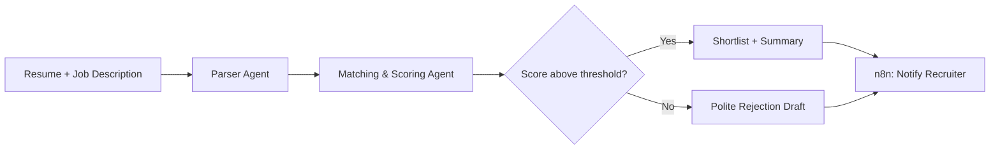

<p align="center">
  
</p>


<div align="center">


</div>

<p align="center">
  
</p>

<p align="center">
  
</p>

<p align="center">
  
</p>

---

## 👨‍💻 About Me

I'm an AI/ML engineer who builds LLM applications end to end: RAG pipelines, fine-tuned models and multi-step agents, shipped with Docker and AWS. I also teach the Full Stack AI Engineer course at DrippinAI Labs.

```javascript
const punit = {
    role: "AI/ML Engineer",
    languages: ["Python", "JavaScript", "SQL"],
    focus: ["Agentic AI", "RAG", "LLM Fine-tuning", "Generative AI"],
    agents: ["LangGraph", "LangChain", "CrewAI", "n8n"],
    retrieval: ["FAISS", "Pinecone"],
    models: ["LLaMA", "Hugging Face Transformers", "Groq"],
    classicalML: ["scikit-learn", "TensorFlow", "Keras", "PyTorch"],
    deploy: ["Docker", "AWS", "Streamlit"],
    currentFocus: "Production-grade agentic AI systems",
    funFact: "There are two ways to write error-free programs; only the third one works"
};
```

---

## 🔧 Current Work

- 🔭 AI Intern at **Industrial Light & Magic (ILM)**, Production Technology, Mumbai
- 🎓 AI Lead Instructor at **DrippinAI Labs**, Full Stack AI Engineer course
- 🌱 Going deeper on **agent orchestration, evaluation and LLM fine-tuning**
- 💬 Ask me about **RAG, agentic AI, LLMs, Python and ML**
- 📫 Contact: **punitgavali29@gmail.com**

<div align="center">
    
</div>

---

## 🤖 Agentic AI

I design agents as explicit state machines (LangGraph), not one giant prompt. Example flow from my recruitment pipeline:



| Project | What it does | Stack |
|---|---|---|
| 🧑‍💼 **Agentic Recruitment Pipeline** | Multi-step agent that parses, scores and routes candidates | LangGraph, n8n, Groq |
| 🏢 **Enterprise RAG Chatbot** | Support assistant that cut support workload by about 42% | RAG, vector DB, LLMs |
| 🏥 **MedQueryDoc AI** | Medical document Q&A | LLaMA-2, Pinecone |
| 🧾 **Receiptorium Chatbot** | Fine-tuned LLaMA 3.2 assistant for a work-tracking platform | LLaMA 3.2, fine-tuning |
| 💳 **Transaction Anomaly Detection** | Flags suspicious financial transactions on a live dashboard | Isolation Forest, Streamlit |
| 🛡️ **PhisProbe** | Phishing link detection, published in IJNTI, IIT Roorkee Productathon finalist | Streamlit, GenAI |

---

## ⚙️ Tech Stack

<p align="center">
  
</p>

<p align="center">
  
  
  
  
  
  
  
  
  
  
</p>

---

## 🏆 Achievements

- 🎯 Finalist at **Productathon AI Hackathon, IIT Roorkee**
- 📝 Published research paper in IJNTI Journal: *"PHISPROBE: Phishing Link Detection Using Streamlit and Generative AI Approach"*
- 🏅 IBM AI Engineering Professional Certificate (2024)
- 🎓 B.E. in Artificial Intelligence & Data Science, FR CRCE Mumbai (8.82 CGPA)

---

<h2 align="center">📊 GitHub Activity</h2>

<p align="center">
  
  
</p>
<p align="center">
  
  
</p>

<p align="center">
  
</p>

<p align="center">
  
</p>

<p align="center">
  
</p>

---

## 📫 Connect with Me

<p align="center">
  <a href="https://github.com/punit2911"></a>
  <a href="https://www.linkedin.com/in/punit-gavali-4066b41ba/"></a>
</p>

<p align="center">
  
</p>
